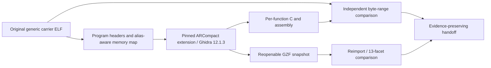

# HGW500 Quantenna coprocessor firmware analysis

> Public source snapshot. [Scope, provenance and verification](docs/PUBLIC_SNAPSHOT.md).

This repository organizes the generic MuC, AuC and DSP carriers and their independent component analysis repositories. Each child preserves the original ELF, byte-checked segment exports, a reopenable Ghidra project and inferred C/assembly output.

## How this component fits



This diagram shows software ownership and analysis flow, not a complete board schematic.
The [system architecture](docs/SYSTEM_ARCHITECTURE.md) explains the ARC750 host,
MuC, AuC, DSP and Realtek 8051, with their memory and firmware boundaries.

## What is established

| Area | Recorded scope |
| --- | --- |
| MuC | 1,094,927-byte ELF; original preserved export has 1,137 inferred functions and 110,398 byte-checked Ghidra instructions. |
| AuC | 33,342-byte ELF; 55 inferred functions and 1,421 checked instructions. |
| DSP | 246,244-byte ELF; 295 inferred functions and 30,251 checked instructions. |
| Coverage and limits | The original checkpoint covers 41.823%, 11.853% and 42.233% of carrier bytes as verified instructions. Byte fidelity and 13-facet GZF roundtrip do not establish full functional recovery. |

## Start reading here

1. [Component handoff](docs/PROJECT_HANDOFF.md): inputs, evidence and next work.
2. [System architecture](docs/SYSTEM_ARCHITECTURE.md): processors and firmware families.
3. [Firmware contents](docs/FIRMWARE_MAP.md): OEM, Core Boot R1 and API v2 R3.
4. [Repository map](docs/REPOSITORY_MAP.md): host drivers, payloads and integration.
5. [Published checkout availability](docs/CHECKOUT_AVAILABILITY.md): actual remote source inventory.
6. [Preserved technical notes](docs/REFERENCE_NOTES.md): detailed earlier results, with workstation paths normalized.

## Work in progress

Continue function discovery, LP-loop semantics and alias/overlay interpretation. MuC symbol recovery has a later separate checkpoint; do not replace the original GZF. AuC command completion does not prove DSP/DMA retirement or make unloading safe.

## Offline verification


```sh
python tools/verify_public_export.py
```

This checks the published file inventory. Original preservation verifiers and
receipts describe the private source checkpoint; they can require omitted native
databases or external inputs and are not a fresh public-snapshot qualification.

## Preservation and scope

This is a public source snapshot; per-unit data and original private histories remain private. Original vendor/GPL source, notices, comments,
carriers and immutable evidence retain their authorship and provenance. Derived
C is labelled as inferred analysis, not silently presented as original source.
Credentials, unit identity, calibration, personalized rootfs/flash images and
workstation-specific configuration stay outside documentation exports.

Documentation prepared 2026-11-10 from recorded source/evidence. No device access,
firmware installation, radio change or new physical qualification is implied.
